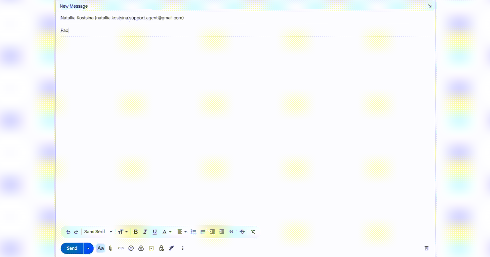

# 📬 AI Customer Support

AI Customer Support is an email assistant for Harbor & Pine, a fictional home and outdoor store that sells on Amazon. It polls a Gmail inbox, classifies each customer message, and drafts a reply from the store's knowledge base. Replies go out only when the rules allow it. Anything else is escalated to a colleague with a short acknowledgement to the customer.

The decision logic is split on purpose. LLM agents read the email and propose a section, a draft, and an issue. Deterministic Python in `app/ai/rules.py` and `app/ai/decide.py` makes the final call on whether the bot may reply, which next step applies, and when a human must take over.

## Demo



## Key Features

* **Gmail Polling:** Picks up new inbox messages on a fixed interval and replies inside the same thread.
* **Classification & Drafting:** A classifier model picks the knowledge base section, and an agent model writes the reply using tools that read the knowledge base.
* **Safe Escalation:** Refunds, angry customers, attachments, late orders, and anything outside the knowledge base are sent to a human. Each escalation adds a `needs-human` label in Gmail.
* **Guards:** Auto-submitted mail, bulk and list mail, and the bot's own messages are never answered.
* **Retries:** Failed messages are retried up to three times before they are dropped.
* **Dashboard:** A React app to browse events, tickets, and messages, and to edit knowledge base entries.
* **Evals:** Golden emails with expected section and action, run through `pydantic-evals`.

## Tech Stack

### Backend

* **Python 3.13**
* **FastAPI** — API and static file serving for the dashboard
* **psycopg** — PostgreSQL driver
* **PostgreSQL (Supabase)** — events, tickets, messages, and knowledge base
* **pydantic-ai** with **Groq** — classifier and reply agent
* **Google Gmail API** — reading and sending mail, and labelling
* **uv** — Python project and dependency manager

### Frontend

* **React 19** and **TypeScript**
* **Vite** — dev server and build
* **Tailwind CSS** and **shadcn/ui** components
* **npm** — package manager

## Project Structure

```
app/          FastAPI app, poller, pipeline, guards, Gmail and database access
app/ai/       Classifier, reply agent, rules, and the decision function
dashboard/    React dashboard (served by FastAPI from dashboard/dist)
knowledge_base/  Markdown source for the knowledge base
supabase/     Database migrations and Supabase config
evals/        Golden emails and the eval runner
scripts/      Utilities: knowledge base seeding, Gmail checks, token setup
playground/   Scripts for trying the pipeline on a single email
```

## Local Development

### Prerequisites

* Python 3.13+
* Node.js 20+ and npm
* [uv](https://github.com/astral-sh/uv)
* A PostgreSQL database (a Supabase project works)
* A Google OAuth client with a refresh token for the Gmail account
* A Groq API key

### Quick Start

1. **Clone the repository:**
   ```bash
   git clone https://github.com/nata-kostina/ai-support.git
   cd ai-customer-support
   ```

2. **Configure the environment:**
   ```bash
   cp .env.example .env
   ```
   Fill in the Google, database, and Groq values. `DASHBOARD_PASSWORD` must be set, or the dashboard API refuses every login.

3. **Install and seed the backend:**
   ```bash
   uv sync
   uv run python scripts/seed_knowledge_base.py
   ```
   Run the seed script from the repository root, because it reads `knowledge_base/` by relative path.

4. **Build the dashboard** (FastAPI serves it from `dashboard/dist`):
   ```bash
   cd dashboard
   npm install
   npm run build
   cd ..
   ```

5. **Start the API:**
   ```bash
   uv run uvicorn app.main:app --reload
   ```
   The API and dashboard are available at [http://localhost:8000](http://localhost:8000).

6. **Start the poller** in a second terminal to process the inbox:
   ```bash
   uv run python -m app.poller
   ```

For dashboard development with hot reload, run `npm run dev` in `dashboard/` and open [http://localhost:5173](http://localhost:5173). Vite proxies `/api` to the backend on port 8000.

### Running Evals

```bash
uv run python -m evals.run_evals          # run golden emails through the pipeline
```
